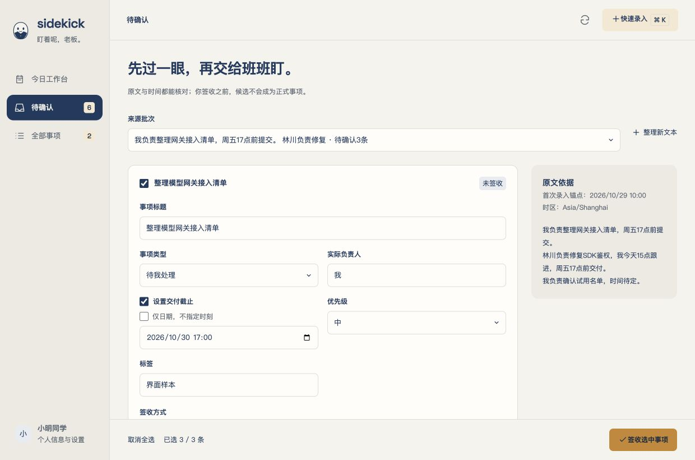

# S2 已跑通真实文本签收，原生完整操作仍待补验

日期：2026-10-29。范围为已批准实施计划§12；实现版本0.2.0。**实现与分层验证通过，原生出口部分未验证**，不标记第一阶段、G0或同事试用版完成；S3未开始。

本轮先将58个S1／个人设置变更提交为`84e67b8f9ba2da4e3098f2f78affb59353392bff`并推送Gitee；最终读回远端main仍匹配。随后S2新增代码、测试及文档保持未提交、未推送。唯一新增生产依赖声明为owner已同意的`sha2 =0.10.9`，锁文件原已有此版本；Pi源码与001迁移未改。

## 1. 当前可用动线

个人入口 → 模型Tab → 保存／测试默认模型 → 快速录入的文本整理 → 来源时间／时区 → Pi organizer → 独立待确认 → 编辑／丢弃／自然语言修改预览并应用／人工关联 → 批量签收 → 今日或全部事项 → 完成与查看原文。

- 手工录入不依赖模型。正常启动无演示数据或自动模型请求。
- 候选、原文、任务和预览先持久化，未签收不创建正式事项。成功零候选、已弃候选及相同来源不会重复整理。
- 签收由Rust事务统一写事项、来源关联、历史、候选终态和幂等记录；关联只增加来源与聚合版本，不覆盖目标关键字段。重复操作返回当前状态，失败不留半批。
- 自然语言修改先产生独立预览，只有应用后才改候选；未保存草稿、旧版本或终态不会被迟到结果覆盖。只改标题时不重算原日期。
- 日期按来源锚点与IANA时区解析；缺来源时间沿用首次录入时间。仅日期保留day精度；歧义、未支持表达或多种可选日期要求核对，不局部截取后猜测。
- 配置保留供应商／模型元数据和凭据引用；双文件journal恢复只发布同一版本，结果未知时停止后续保存及模型任务。密钥只写系统钥匙串，不回读到前端。
- 本次任务固定非秘密配置快照，总期限120秒；Bash默认30秒、最大60秒并受剩余期限约束。宿主／Runtime／工具守护的存活通道与进程组清理已测试；工作根不是沙箱，不对任意主动脱离托管的脚本作强回收承诺。
- schema v1先做WAL一致备份，再事务应用002；保留原事项、历史序号和旧操作重放。旧S1包拒绝schema v2，完整恢复／切根界面留S5。

## 2. 证据按层解释

| 证据层 | 实际结果 | 不证明什么 |
|---|---|---|
| 自动业务／故障回归 | 最终`npm run check` exit 0：JS 61 passed、Rust 40 passed、1个真实模型用例默认ignored；类型、fmt／Clippy、工具链与bundle smoke通过 | 不替代真实WebView点击、多屏或另一台机器 |
| 真实模型＋业务宿主 | 显式`SIDEKICK_MODEL_ENV="$PWD/.env.deepseek" npm run test:s2-live` exit 0，最终源码重验1 passed，14.87秒 | 不代表个人工作材料上的提取精确率，也不代表原生完整操作通过 |
| 普通安装包 | `npm run probe:app` exit 0；`codesign --verify --deep --strict --verbose=2 …/Sidekick.app` exit 0；arm64、ad-hoc、未公证 | 未验证非开发机／最低系统／Intel兼容，不是推广就绪 |
| 浏览器界面 | 冷加载真实Vue／CSS＋API替身；配置草稿、文本、候选、预览、关联、签收、原文追溯及完成走查；1240×820和640×900无横向溢出、签收条可见；最终浏览器warn／error为0 | 替身不执行真实模型、SQLite、钥匙串或Tauri IPC；刷新替身会复位，不作为重启恢复证据 |
| 隔离原生包 | 本轮早期包完成默认工作根、个人页默认Tab、模型JSON导入、本地合成模型连接测试、手工目标、4候选、保存候选、丢弃1条；改写任务后台succeeded，SQLite quick_check为ok | 末轮修复后未完成原生重验；API Key安全输入自动化未完成，未据此认定GUI钥匙串路径通过 |

最终真实模型使用同一vendor Pi与随包organizer，逻辑模型ID不同于API ID，所选实际模型为`deepseek-flash`。合成材料得到3候选，**未签收阶段正式事项0**；修改预览只改标题并保留原日期，应用后丢弃1条。人工创建1个已有目标，再将2条候选签为1个新事项＋1个来源关联，正式总事项2；目标的既有完成状态及关键字段保持。完成新项、重复签收、重复导入、关闭存储再重开，结果一致。测试使用隔离工作根与凭据命名空间，结束执行清理；不把样本装进普通包。此前115.47秒为首轮同路径记录，最终14.87秒只是本次观测，不作性能承诺。

真实后端测试直接调用与IPC共享的Runtime／存储方法，不是原生窗口端到端测试。受控模型测试则经实际打包Pi覆盖API ID、401、非法输出、有界重试、取消／EOF／期限；额外触发Pi完整工具输出落盘，核对私有任务目录及0600权限。

## 3. 独立评审发现已修复

R3设计经A／B面复评通过后实施。交付评审先给出阻塞结论，补失败回归后修复；最终两面第2轮均`APPROVE`，无遗留P1／P2发现。

| 发现 | 修正与可检出的反例 |
|---|---|
| 日期只匹配部分表达会误解“下下周五／一刻／UTC”等 | 检查完整表达的未消费内容，无法支持就待核对；`s2-dates.test.mjs` |
| 仅日期在Apia跳日边界可能永不逾期 | 按下一实际存在的民用日计算日终；日期与今日客户端回归 |
| 保存／重读可能吞JSON草稿，旧连接成功可能被误认对应新配置 | JSON参与dirty、请求签名保护、两个编辑器互保草稿、显式还原、忙时禁用；`s2-client.test.mjs` |
| 守护异常退出会先注销登记，遗漏普通Bash后代 | 注销前回收所属组；先确认sleep运行，再SIGKILL守护并断言子进程消失；`s2-bash.test.mjs` |
| Pi截断后的完整输出会落系统临时目录 | 宿主和Bash的TMPDIR指向受校验任务目录；实际打包Pi落盘测试验证位置及0600权限 |

同时保留配置认证载体／损坏journal、备份失败／DDL中断、签收第二条失败全回滚、同目标多候选、取消与结果竞争等反例。37项存储用例包含在最终40项Rust中，不重复累计。

## 4. 原生和历史未验证项继续保留

原生捕获连续返回ScreenCaptureKit `-3812`，无法可靠观察后续预览应用、关联／批签收、详情和退出重开；最终复查仍失败。本轮没有录到完整原生动线，不把后台成功或浏览器截图当补验完成。上述项目仍需在可捕获的真实WebView上逐步操作并核对数据库；不影响已取得的真实模型后端证据。

S1个人信息完整原生点击／重启及S0剩余项原样保留，详见各历史报告。包括真实Minutes分支、@消息对照／分页、长连接网络重连、独立登录，以及多屏／拔屏／全屏、逐像素穿透与拖拽、登录启动、通知拒绝、跨应用快捷键冲突、完整资源占用和非开发机安装。未在本轮开展飞书收集／消息、桌宠、提醒或日报；S3的三个角色配置、Skills和MCP完整动线也未提前实现。

## 5. 重跑入口与产物

执行命令均来自package scripts。`test:s2-live`仅在明确提供本机配置路径时执行；不要在聊天、配置JSON或日志中粘贴密钥。原生合成验收使用`npm run build:s2-verify`与`npm run dev:s2-native-model`，仅本机127.0.0.1服务；界面夹具使用`npm run dev:profile-ui`。本轮临时服务与验收窗口已关闭。

普通包：`src-tauri/target/release/bundle/macos/Sidekick.app`。版本、源码／产物哈希、命令和截图来源见[结构化证据](s2-20261029/evidence.json)。生产dist已核对包含真实整理／签收命令，不含界面夹具和合成服务标记。

[桌面候选截图](s2-20261029/confirmation-final-browser.jpg)、[窄窗截图](s2-20261029/confirmation-narrow-browser.jpg)、[完成后工作台](s2-20261029/workbench-browser.jpg)均为**合成API替身的浏览器界面证据**。它们用于检查布局、状态和按钮层级，不证明真实模型结果或原生能力。

