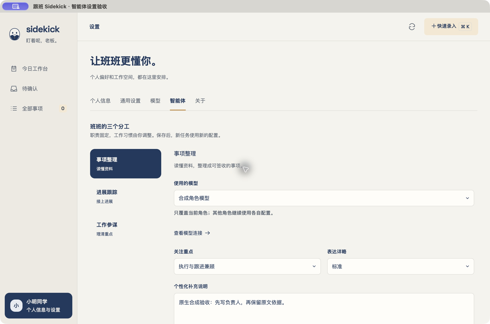

# S3.1 三个角色可配置，事项整理可真实隔离试跑

日期：2026-10-29。版本：0.3.0。owner已确认实施计划§13的S3.1；本轮实现与分层验证完成，后续切片未开始。HEAD仍为本地S2提交`8db8253`；本轮未提交、未推送。历史原生未验项继续保留。

## 1. 用户现在可以完成的操作

个人入口 → 智能体Tab → 固定的事项整理／进展跟踪／工作参谋 → 模型继承或覆盖 → 关注重点／表达详略／补充说明 → 保存或恢复当前角色默认 → 重开恢复。

事项整理另可执行“保存 → 合成样例 → 真实模型试跑 → 只读预览 → 查看本次原文与设置”。有未保存草稿或未确认的保存结果时不能试跑。结果保留标题、类型、负责人、标签、截止／跟进及原文依据，但没有签收入口，不创建正式来源或候选。配置变化后，旧结果明确仍对应旧快照。进展跟踪与工作参谋仅配置可用，试跑明确暂未开放，不显示模拟成功。

原文本整理／修改预览也使用事项整理的配置；模型页“测试连接”始终测试全局默认模型。角色覆盖引用被保护，不能移除／禁用后静默换模型。配置存于工作根`config/agents/<roleId>.json`，仅三个合法ID；缺文件读默认，坏文件／未知版本／链接不会被覆盖，保存采用修订检查、私有原子替换及错误读回对账。

## 2. 每层证据分别解释

| 层级 | 实际结果 | 范围限制 |
|---|---|---|
| 最终自动检查 | `npm run check` exit 0，JS69／Rust47通过，2个真实模型用例默认ignored；类型、fmt／Clippy、工具链及bundle smoke通过 | 不能证明真实服务、原生窗口或其它机器可用 |
| 真实模型与生产宿主 | 显式`SIDEKICK_MODEL_ENV="$PWD/.env.deepseek" npm run test:s31-live` exit 0，末轮1 passed、12.54秒，3预览 | 生产Rust方法＋随包Pi，未走原生GUI真实Key输入；无提取准确率或性能承诺 |
| 打包Runtime与受控模型 | S2／S3.1共9项：实际API ID、角色／偏好参与请求、trial工具为空、非法角色、原有失败／重试／取消／期限等通过 | 受控HTTP不是外部真实模型 |
| 原生隔离包 | 实际Tauri IPC、磁盘配置、三角色保存、模型覆盖、退出后最终包重开恢复、当前角色恢复默认、合成服务试跑与3条只读结果可见 | 使用本地合成模型与非秘密环境引用；不据此认定GUI钥匙串输入、真实模型原生E2E或历史原生缺验通过 |
| 浏览器界面 | 冷加载真实Vue／CSS＋API替身；未保存禁试跑、角色切换、保存、结果显示、1440×1000与640×900无横向溢出、无重复DOM ID、左右键切页后配置保留；最终warn／error为0 | 不证明真实数据库、模型或IPC；替身刷新复位 |
| 安装包 | 隔离包与普通`Sidekick.app`构建exit 0，codesign deep／strict均exit 0 | 当前开发机macOS27.0.1 arm64，ad-hoc、未经公证，未在另一台机器安装 |

真实模型验证故意将全局默认指向不可调用的对照模型，事项整理单独覆盖为已选DeepSeek；成功结果证明调用来自角色覆盖。补充说明要求添加`S31试跑`标签，结果中实际出现。开始前已有1条正式事项，结束仍为1条，业务历史不变、来源0；三个角色配置及隔离结果在关闭存储后重开仍恢复。密钥仅从owner指定文件载入隔离钥匙串，经stdin进入Runtime；临时根和凭据条目在测试结束执行清理。初验12.22秒／4预览是前一轮观测，末轮结果为12.54秒／3预览，不混用计数。

原生验收应用标识`com.sidekick.s31.verify`，从未打开普通用户根。原生在早期包保存三份配置并试跑，关闭后打开最终构建，实际观察到覆盖、补充说明及旧结果恢复；恢复工作参谋默认未影响事项整理，再执行一次最终包试跑。只读SQLite核对`todos/sources/candidates/todo_events`均为0，`agent_runs`有2个succeeded、完整性检查ok，见[原生存储核对](s31-20261029/native-storage-checkpoint.json)。它与真实模型后端的“1项正式事项不变”是不同的隔离样本。

## 3. 存储升级与本步边界

003只追加当前需要的`agent_runs`，不修改001／002或原S2 `runs`语义。v1／v2升级前做WAL一致备份，DDL失败回滚；覆盖v2未checkpoint事务、历史保留和v1直升。旧包拒绝schema v3，不能直接降级数据库。MCP的`tool_calls`随S3.3另做追加迁移，不预建未使用表，也不会回改003。

试跑与原业务共享一个执行槽，按Job类型分流；trial工具列表为空，宿主只写隔离结果。现有120秒总期限、取消、进程清理、迟到结果拒绝和冷启动中断处理继续生效。该试跑边界不改变既定产品的通用Bash能力，也不宣称工作目录是沙箱。Skills／MCP加载、另两角色试跑、advisor今日建议均待后续；桌宠未提前接入。

## 4. 独立复审与回归

A／B面首轮各有1项P2，均先取得失败回归，再修复；第2轮两面均APPROVE，无未关闭P1／P2。

| 发现 | 修复与证据 |
|---|---|
| 恢复／保存已提交但IPC响应丢失，旧配置仍被当可用 | 无法确认的错误将配置置为不可试跑，保留草稿；显式读回后才恢复。覆盖save与reset响应丢失；不会以默认配置悄悄执行 |
| 旧取消响应／异常迟到，覆盖新任务 | 返回前同时校验请求代次及runId；覆盖并发取消A、轮询确认终态、启动B、A响应迟到的顺序，B仍运行且继续轮询 |

聚焦`test:s31-domain`6 passed、`test:s31-store`7 passed；44项存储回归包含这7项，最终47项Rust另含S0用例，不重复累计。一次直接并行执行Rust fixture出现WORKSPACE_IO，未记为通过；改按项目既有串行脚本重跑44／44，最终配置门禁通过。最终全量在复评与代码稳定后执行，未反复以全量代替聚焦检查。

## 5. 保留的未验项与复测入口

S0的真实妙记／@覆盖／网络重连、窗口穿透与多屏／全屏、登录启动／通知等，以及S1个人信息完整原生动线和S2原生完整签收／重启仍保持原记录状态。本轮只验证S3.1新增正常路径；没有补验原生真实密钥输入、原生取消／强退完整过程、减少动效系统切换或第二台安装。收尾时原生捕获再次出现ScreenCaptureKit -3812，不抹掉已取得的本步截图，也不因此关闭其它缺项。一次浏览器Playwright按键调用超时，改用受支持的按键接口后已实际观察左右切页；未把失败尝试算通过。

重跑命令均已放入package scripts：`test:s31-domain`、`test:s31-store`、`test:s31-runtime`、显式配置路径的`test:s31-live`及`build:s31-verify`。`dev:profile-ui`仅供浏览器替身；`dev:s2-native-model`仅为127.0.0.1合成模型，不外发业务材料。本轮临时服务／窗口已关闭，合成原生数据保留在独立验收根供复查。

[结构化证据](s31-20261029/evidence.json)保存命令、源码／产物哈希、截图尺寸及来源。普通包位于`src-tauri/target/release/bundle/macos/Sidekick.app`；正常启动无演示事项或自动模型调用，产品不会自动读取`.env`。

[原生试跑结果](s31-20261029/trial-native.jpg)采用真实IPC与本地合成服务；[桌面浏览器](s31-20261029/agents-browser.jpg)与[窄窗浏览器](s31-20261029/agents-narrow-browser.jpg)仅为API替身界面证据，不与真实模型证据混淆。
