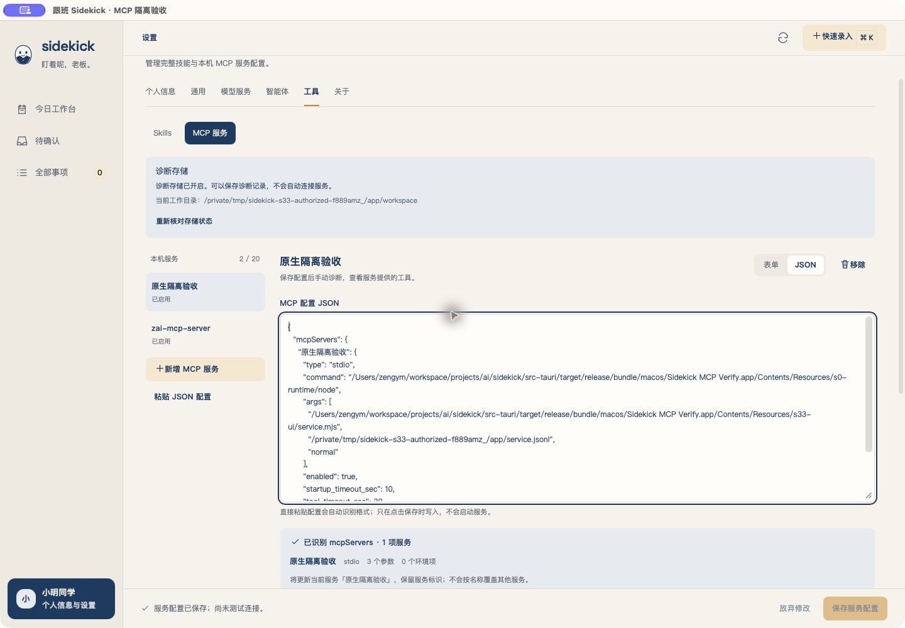
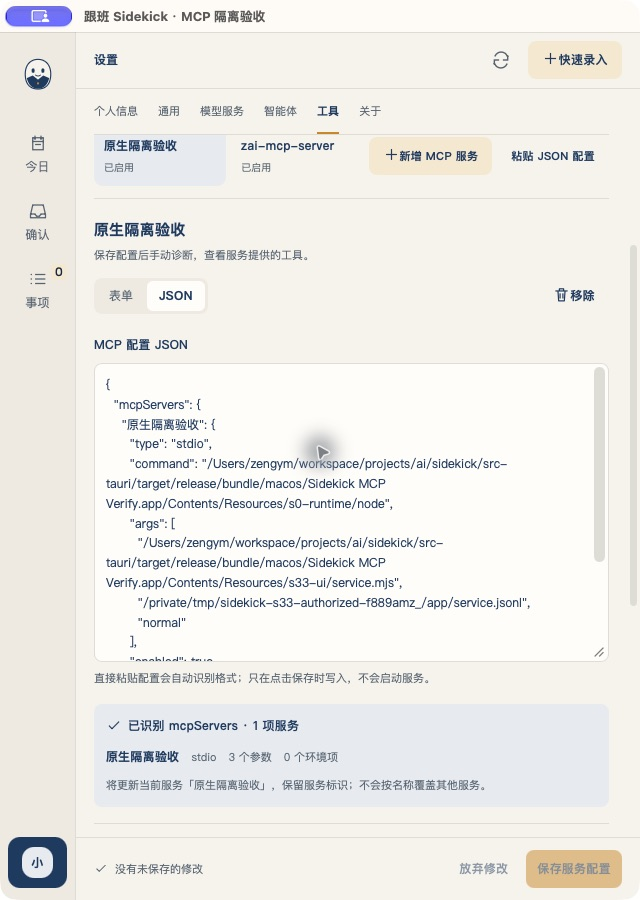

# P2 的 MCP 配置采用表单／JSON 双模式，保存仍不启动服务

本轮依据owner的配置体验反馈、ZCode截图及明确答复“保持P2：完善stdio配置，HTTP仅识别并提示”。截图中的凭据未转录、未用于测试。品牌、生产Keychain关闭、既有配置／IPC／数据库／Pi源码及P3／P4边界不变。当前记录持续追加实际证据，未取得的验收不预签。

## 配置格式是客户端约定，执行仍由 Pi 客户端和托管传输承载

- 固定Pi源码的[MCP说明](../../vendor/pi/packages/coding-agent/docs/mcp.md)采用`mcpServers`，原生支持stdio与Streamable HTTP。Sidekick仍走应用自己的私有配置与进程管理，不能直接照搬Pi的自动连接、环境表达式执行或OAuth行为。
- [MCP规范](https://modelcontextprotocol.io/specification/2025-06-18/basic/transports)定义JSON-RPC与stdio／Streamable HTTP传输，不统一各客户端的配置文件格式。
- [Codex官方文档](https://developers.openai.com/codex/mcp)的主配置为TOML。本轮只适配其字段的JSON表达，不声称能直接解析`config.toml`或所有客户端字段。

| 输入形状 | 本轮行为 |
| --- | --- |
| `{"mcpServers":{"name":{...}}}` | 自动识别，默认推荐格式 |
| `{"name":{...}}` | 自动识别服务名映射 |
| `{"command":"node","args":[...]}` | 当前服务名／new-server；可切表单改名 |
| `{"mcp_servers":{"name":{...}}}` | Codex字段的JSON表达，非TOML |
| `{"servers":{"name":{...}}}` | VS Code包裹形状；不执行input交互 |
| 多项或stdio与HTTP混合 | 选择一项，单独保存；其他项不落盘 |
| HTTP／Streamable HTTP／SSE | 识别并提示尚未接入；禁止保存和诊断 |
| 重复键、未知字段、错误类型、冲突期限 | 固定文案说明，保留原输入，不猜测或丢弃 |

stdio支持command、独立args数组、绝对cwd、enabled、env与env_vars。整值`${NAME}`／`${env:NAME}`转为显式宿主引用；普通非秘密字符串原样保留。秘密名称的直接值、不支持的内插／`!command`拒绝；已有安全值或不能无损表示的literal继续表单编辑，不导出内部引用。

超时缺省连接10秒、工具30秒；`timeout`为Pi秒，映射工具期限；`startup_timeout_sec`／`tool_timeout_sec`分别映射；`timeoutMs`为本产品明确提供的毫秒别名，映射两者，另支持connectTimeoutMs／toolTimeoutMs。冲突不猜优先级，超过连接1–30秒／工具1–60秒不截断。协议版本由Pi握手协商，没有无接线的版本选择器。

JSON只留进程内草稿，切服务／页签保留；保存走原修订／未知结果核对，不按名称改变其他服务。较新原文不因旧响应被清除。既有服务的ID不变。配置解释、模式切换与保存不会启动服务；诊断必须手动进行，未保存JSON时禁止诊断。

## 方案与交付审查

R2、非批量，单面独立评审。方案首轮Major为literal占位符往返冲突，补拒绝策略后复评APPROVE。代码首轮4项P2均采纳：重复env静默覆盖、1001毫秒浮点往返、未知type回显、真实新增无名单对象无入口。四项均有实际失败反例，修正后配置域33/33通过；第2轮独立复审APPROVE，并由评审者实际重跑33/33。结论只覆盖代码和聚焦回归，不替代最终原生与全量证据。

## 已执行与尚待执行

- `npm run test:s33-config-domain`：33通过；包括24项新解析／真实Pinia草稿用例。
- `npm run test:s33-security-domain`：7通过。
- `npm run test:s33-ui-domain`：18通过。
- `npm run test:layout-domain`：14通过。
- `npm run typecheck`与`npm run build`：通过。构建保留已存在的大于500KiB chunk提示；上一轮649.26kB，本轮初验661.33kB，不借本轮扩做分包。
- 浏览器合成IPC：多项识别、HTTP禁止、单项保存、表单还原空参数／含空格参数已操作；DOM1440×1000和640×900文档未横向溢出，控制台warn／error为空。截图原始字节保留，不以夹具代替原生。
- 首个中间原生构建通过，已核对同隔离根v4／生产凭据关闭；为纳入审查修正正常GUI退出exit0，未在该构建执行MCP业务。最终证据见下节，不以中间构建代替最终源码。

当前隔离根在新版编辑前已有17条agent_runs，正式业务四表及tool_calls均0；此基线在隔离启动后、UI编辑／诊断前采集。此前一次拟采集脚本因`/tmp`与`/private/tmp`相对路径不一致而失败，未产出基线；没有把它算作启动前证据。旧记录完整保留，不将owner上轮复验产生的记录当本轮自动操作。

P2整体、两个规定尺寸的历史签署、真实秘密／普通用户根及全部历史未补验项继续保持原状态。无HTTP真实连接、智能体MCP调用或P3／P4推进。

## 最终源码的全量与原生验收已执行

`npm run check`于UTC 2026-10-31 06:53:56至06:57:13执行，exit0，六个生产／测试输入哈希前后一致。Node **266通过**；默认Rust **126通过、2项原有ignored**，双特性 **8通过**。两实际macOS包构建、deep／strict签名与受控资源排除通过；沿用此前许可的S0合成钥匙串与旧受控调用，没有使用截图凭据或真实模型。完整check包含既有工具调用探针，不能把整套check写成零tools/call。原始输出见[日志](s33-p2-json-20261031/raw/full-check.log)，执行与哈希见[记录](s33-p2-json-20261031/full-check.json)。

同隔离根／nonce、scope `controlled-upgrade-no-credentials`，仅操作“原生隔离验收”这一受控本机服务，没有连接owner另存的服务。中间10与最终11／12三次GUI退出均exit0；正常包未打开真实用户根。使用公开CUA与AX已暴露的Raise，不改权限、系统设置或控制工具。

| 实际原生路径 | 证据与结果 |
| --- | --- |
| 读取原配置、表单／JSON切换 | 原稳定ID及配置恢复；8张原图／AX记录 |
| 非法JSON后尝试切表单 | 原输入保留、停留JSON、保存和诊断禁用 |
| 粘贴stdio＋HTTP两项，键盘选择HTTP | 自动识别2项，固定错误提示，不能保存 |
| 选择stdio后保存，再切表单 | 仍2项已存服务；含空格参数和空参数均持久化，未导入HTTP |
| 保存不会启动服务 | 当时agent_runs仍17，服务日志SHA不变，见[保存读回](s33-p2-json-20261031/native-save-proof.json) |
| 正常JSON保存后手动发现 | 真实initialize／两页tools/list，2项工具，清理完成后才成功 |
| JSON改wait-list，保存后诊断／取消 | GUI取消为cancelled，没有发布新目录 |
| 恢复原始normal，再手动诊断 | 再次成功；正常GUI退出 |
| 同根冷重开、窄窗切JSON | 21条记录、配置和服务日志逐项不变，未自动连接；库完整性ok、外键错误0，见[冷读回](s33-p2-json-20261031/native-cold-readback.json) |

原生本轮新增4条记录：2 succeeded、1 cancelled、1 MCP_TIMEOUT。超时来自验收者向夹具追加“one argument／空参数”做往返后直接执行：夹具`service.mjs`将首个追加参数解释为自身role，因而不启用service握手。已通过夹具源码与服务日志role逐项确认；保留失败记录，恢复标准三参数后成功，不修改产品来掩盖。表单／JSON确实保存了这两个参数的证据独立成立，不能把该次超时计为正常诊断通过。

服务日志在本轮观测到initialize **3**、initialized **3**、tools/list **5**、tools/call **0**；该计数只指受控服务已记录的方法，首条超时的角色没有记录收到的initialize。原生正式业务四表及tool_calls均0，原17条记录完整保留；其他已存服务从首次保存读回至收尾哈希一致。没有删除或覆写任何历史记录、数据库或已有六份用户启动记录。当前无本轮原生／受控服务残留，浏览器夹具服务已正常停止。

原图实际为1440×1000与640×900窗口捕获，含标题栏。已检查宽窄布局、JSON换行、下拉选择、错误提示、焦点与固定保存栏；未裁剪／缩放来补证。启动native-info仍可能是异步尺寸生效前的数据，因此不把它当作当前内容viewport。历史“精确内容高度”签署继续开放，未因本轮窗口图尺寸吻合而补签。

设计检测终态无发现。先前新增的命名等宽字体已改为既有字系；8px圆角与11px帮助文字与既有设置规范／CSS一致，仅在`src/styles/mcp.css`为这两个数值登记窄范围例外，未关闭规则或整个文件。品牌令牌、公共组件和字体未改。

最终独立证据核实APPROVE：当前六输入SHA、32份产物SHA／大小、原始门禁统计、8张原图／AX、隔离库21条记录与四表／tool_calls零行、服务日志原前缀／增量、原六文件及三次GUI退出均匹配。审查未重跑GUI或重门禁，不替历史缺项签署。当前任务改动保留在工作区，未提交／推送；原09用户启动记录及原02–04六文件保持独立，不代其整理提交。

## 工作区整理与本地提交（2026-10-31）

owner随后授权整理并提交当前工作区。本次将MCP源码、测试、说明、32份验收产物及其清单，以及原02–04、09–12共14份启动／退出记录一并纳管；上文“未提交”描述的是功能验收收尾时的历史状态。

清理计划经独立聚焦评审APPROVE，实际仅删除24个已忽略且未跟踪的对象：18份与已纳管证据SHA一致的重复日志、4个可再生目录（Runtime、生命周期探针、前端构建与Tauri schema）、一次性提交草稿及设计检测缓存。合计511个文件、180,086,858字节；7个保护对象的清理前后哈希一致，包含本机密钥、IDE资料、隔离验收目录与原生验收包。依赖、Rust编译缓存、Pi源码及历史唯一证据保留。后续现有`probe:app`／`build:s33-ui-verify`命令会重建Runtime和前端产物。

本次重新执行`npm run build`（含typecheck）及配置／安全／UI／布局四组域测试，均exit0，合计72项通过；保留既有chunk体积提示。此前完整check的32份证据与6个输入哈希再次核对一致，未重复声称已执行完整原生验收。原始构建日志和AX记录按SHA保留，包括工具输出的空格；人工编写文件另做暂存差异检查。仅本地提交，不推送，不推进P3／P4，历史未补验项状态不变。
