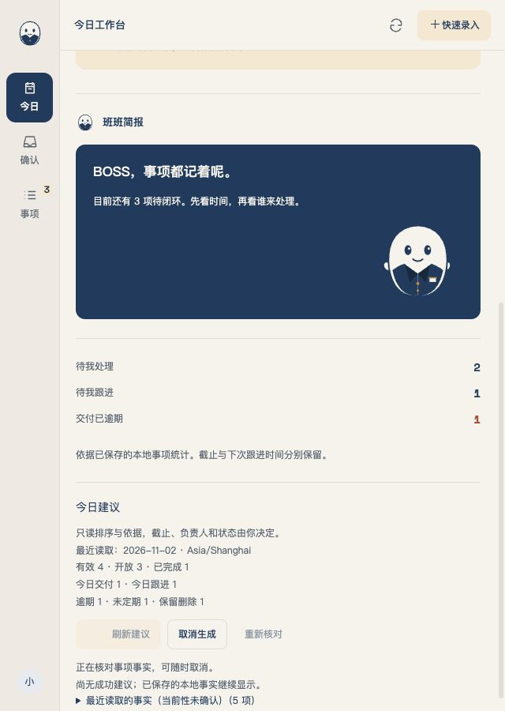
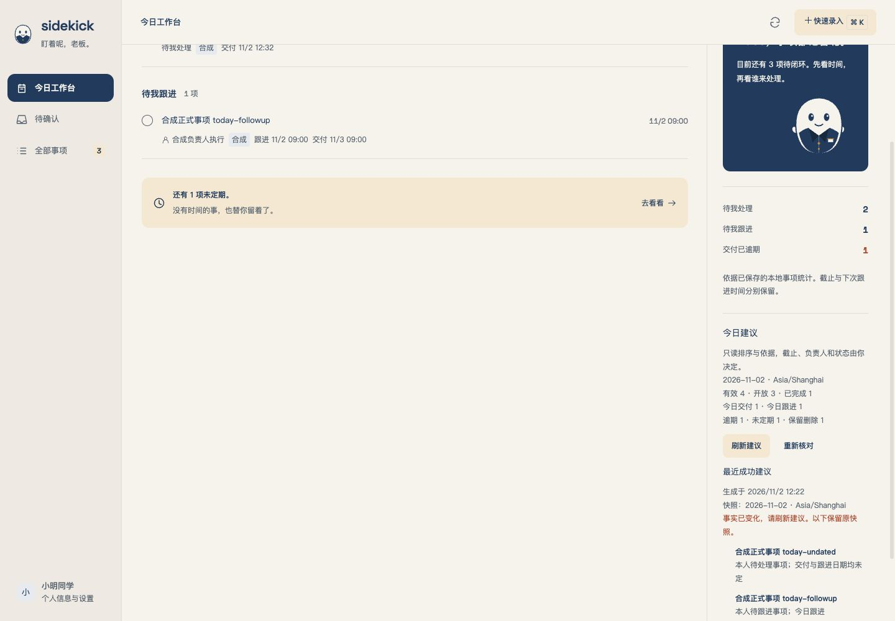

# S3.5 N3 今日工作台建议：独立交付与合成验证记录

> 当前结论：最终交付第3轮A／B准出，新的独立fullAttempt2与两包后验pass；Root本地提交及提交后NEW exactHEAD核实仍待（提交前时点）。首次fullAttempt1的失败原样保留。不是N3完整验收、原生或发布结论。实施状态唯一来源为[实施计划](../product/05-第一阶段实施计划.md)。

## 范围与授权

基点`c783c8560cde2269eed721ee206d53b0f7e022cf`。R3、非批量的一条今日工作台纵切片：正式签收的合成事项、独立today_advice用途、完整事实与宿主计数、模型只读排序／依据、当前性与迟到、最近成功和失败重开、取消／冷启及必要005升级守卫。N1／N2、S2及MCP旧owner／历史保持原义。

owner明确授权N3必要追加SQLite迁移及版本／结构／升级守卫，保留001–004与旧数据语义；其后明确“保留 N3 必要迁移授权，取消 08:00 暂停并继续（推荐）”。旧no-DDL与07:30／08:00仅保留为历史。仍只用合成模型、本机受控服务与临时根，生产MCP钥匙串关闭，不读真实模型环境文件／旧预算、不动真实根、不重试S3.4原生；最终仅Root本地提交、不推送。

## 同一设计的准出与实施偏差

首轮A／B各一Major（分钟边界当前性、COMMIT／ROLLBACK未知屏障），修订后第2轮均APPROVE，core-v3封存保持。实施期ready／release反例又实际证明同步helper持两锁使取消不能及时持久；fresh技术裁决推荐同run先保存完整raw，锁外准备，一次绑定fullfacts。补充核对§18.1兼容JSON／IPC及细化授权后关闭owner授权缺口，仍明确要求修核心和完整重评，不把专家当设计批准。

最后第3轮fresh A3／B3均APPROVE，发现0，绑定core-v4-final：26640字节、SHA`e966f760add123b5d452420f6ddf8aaf32e9cb3c2080aca26d69643d49284da5`，与05§18.6逐字对应。原v3／v4草稿、前轮发现与全部needs_revision材料保留，没有换名重置。B3如实披露读到非N3旧S3摘要；未读N3对面报告／作者会话，旧摘要未作本项准出证据。精选绑定见[设计摘要](s35-today-20261102/review-summary.json)。

准出后实现了版本1完整raw／running身份提前持久、可立即取消handle、锁外helper和两阶段读取、一次条件绑定、raw-only非成功与旧full兼容。模型初始payload在同一短slot→store区核owned／running／完整facts／cancel／deadline并非阻塞try_send一次发布，不加ACK／工具权限。helper有单帧、字节／期限、stdin生命线、PID与进程组归属；Host总单调120秒预留回收，Node剩余预算取整数，避免SDK整数校验误报超时。当前性使用半开有效期回执、IPC接收复核、唯一所属timer与tick／可见恢复校验，不把清错误当权威重读。

这些是同一已准出核心的实现；未降低正式写集、模型排序／依据、raw完整性、success fullfacts、取消、最近成功／重开或迁移验收。

## 实际命令与覆盖

每个结果只代表相应层和运行时点。原始命令／退出码／计数／日志SHA在`build/night-20261101-s35/n3-validation/index.json`及各runner结果JSON；精选见[验证摘要](s35-today-20261102/validation-summary.json)。

| 检查 | 实际结果 | 主要边界 |
|---|---|---|
| `npm run test:today-store` | exit0，33通过＋1受控子入口ignored，41.58s | 包含store／host准备、取消、全阶段派发屏障、timeout、helper EOF／强杀冷启、raw-only、一次绑定、旧full、读取源／active竞态、expiry／null／read-wide5秒；ignored入口由crash父用例真实启动并强杀 |
| `npm run test:today-domain` | exit0，26通过 | 完整raw／日期／DST／计数、严格模型理由／排列、IPC有效期、读取／启动／取消／升级异步归属与当前性 |
| `npm run test:today-runtime` | exit0，5通过 | 实际打包Node／Pi，本机合成HTTP；多合法顺序／空、非法事实／工具载荷联网前拒绝、非法结果及不足provider上限的单调预算、真实source／bundle helper的单块／ACK跨UTF-8块与大帧 |
| S31／S2／Skills Runtime | 各exit0：10／7／3通过 | 三角色旧试跑、正式文本与原Read／Bash／Skills路径 |
| 角色配置／tracker Pi／advisor Pi | 各exit0：14／4／6通过 | 原配置／快照／试跑及写集语义 |
| MCP schema／升级／调用 | 各exit0：20／8／35通过 | 合法v5兼容、损坏v5结构拒绝、未来v6拒绝、旧owner／unknown与升级确认 |
| MCP HTTP任务／formal | 各exit0：12／21通过 | 原正式事务、配置冻结、调用与恢复接线 |
| fmt／默认与双特性Clippy、type／结构／文档 | UI最终变更后再次全部exit0（post-ui-results.json） | 不把局部检查代替原完整check；无新增allow绕过 |

升级用例包括v1–v4、原列／rowid、现存事件sequence、tool_calls FK／owner、未checkpoint WAL一致性备份、独占私有文件／同步／路径及DDL／commit／rollback／ON恢复未知屏障、普通v1/v2仅到3、target4／5确认隔离与忙槽拒绝。001–004原字节保持，005不自动开根执行；不改变原002对已删除尾事件内部sqlite_sequence高水位的既有语义。

旧c783原guard另外在全新独立基线clone实际调用未改local_store.rs：v4正控、真正005结构v5精确SCHEMA_TOO_NEW、mainDB字节／schema／全表rowid行不变，1用例／1通过；Root已实读raw并逐项核48文件seal。元数据前置错误、公开catalog首试超时与一次受控重试、原49文件failed seal均保留。该窄pass不代当前升级器、安装包或完整check，相关输入不变时不重复。

## 真实Vue合成IPC与回收

[UI摘要](s35-today-20261102/ui-summary.json)绑定19个主场景、1440×1000和640×900。实看升级默认禁用／Space确认与Enter／Esc焦点、成功3项模型顺序与完整5项事实、长文／Tab／scroll、raw准备和延迟读取时取消仍可用、迟到与重开、空清单／空建议、模型失败／最近成功／过期、备份失败需新确认、未知阻断、读错恢复、实时expiry与timer归属。主场景console warn／error、document／advice横溢出及重复ID均0。

UI发现均保留原红后最小修正：dialog全局margin导致左上，补明确居中；原表达误作canonical日期，改按保存atMs及各快照zone显示并独立保留原表达；精确边界刷新后旧rail仍按旧now为0、新宿主统计1，现随已读取／边界同步now后两处1／1一致。读错保留旧成功但撤销currentVerified，仅成功所属权威读取恢复；新timer在第二次读取后5002ms触发第三读，没有旧2.5秒回调抢占。相关JPEG与DOM均为实际采集，不编辑补图。

初次offscreen、一次性错误已被自动读取消耗、重导航夹具重置raw、selector有效等待短于新5秒等取证限制均在原summary注明，未以这些图作主验收。原图／DOM／39文件seal与cleanup在`n3-ui/final/`。只签Vue合成IPC，不签真实Tauri／SQLite或原生；后端持久性由Rust／Pi矩阵另证。Vite按PID／PGID／argv／UTC启动时间核实后退出，1476无LISTEN；临时IAB关闭、viewport恢复。

## 交付首轮发现与修正

fresh互盲A1为BLOCK／needs_revision，B1为APPROVE_WITH_CHANGES／needs_revision。合并3项并整轮处理：helper把各块Buffer隐式解码破坏中文（P1，Rust会拒收而非污染）；直接AppStore MCP入口遗漏Today未知屏障（P2，LocalState外层已阻断，不声称普通IPC能绕过）；升级确认前未显示备份位置（P2，两面重复）。原报告／封存与v1源码tar保留，[当前处置摘要](s35-today-20261102/delivery-summary.json)只记实际事实，不代独立复审。

正式ACK分块实际helper反例exit1，465B标题变为替换字符；修正为按原字节累计有界Buffer，整帧一次解码，受控fixture用增量UTF-8。source和重新bundle的helper均覆盖单块、确定性多字节拆块、100条大帧。直接AppStore CommitResponse后MCP状态／升级原均OK的反例exit101；共同verify_mcp_paths前置补Today屏障后，新聚焦Rust33＋1内部ignored、MCP schema20／security20、Runtime5均exit0，默认及双Clippy／fmt／type同0。005与旧迁移／guard runner不变。

确认前现显示当前root/backups/与before-schema-5命名示例，完成后仍显示确切回执。1440／640实际DOM和图证明未确认按钮禁用、Space后启用、Esc回启用按钮，console及横溢出0。该增量仅签Vue合成IPC；6文件seal和cleanup在n3-ui/delivery-r2。原19主场景与旧缺口图没有被覆盖。

## 首次独立完整门禁与最小夹具修订

非作者全新clone按原50输入标准npmci／CLI／Pi／bundle／structure均0后，唯一原`npm run check` attempt1实际exit101、627.434秒，Node780／780；Rust先17／0，后269通过／1失败／3ignored。失败是旧MCP恢复测试result-tail预期RUNTIME_PROTOCOL而得MODEL_TIMEOUT。后续budget／toolchain／Runtime和两包未执行，不能签完整通过。4300输入与双仓index／raw／Gitblob／ownerExec前后严格稳定，94身份／6PGID清理owned0／unknown0／listener0。原metadata gitadd ignored-parent失败、50精确私有index修正及原full红保留，[完整失败摘要](s35-today-20261102/full-attempt1-summary.json)绑定121文件seal，不覆盖成通过。

原脚本／测试未变不能证明历史flake。fresh Tier2E先纠正计时起点：Python／Node总启动时间不等价Rust计时窗口；同std-only Rust探针测到reader后冷复制坏尾1209.963ms、同inode有界准备后35.090ms、私有symlink28.483ms。原full的准确时序缺失，这些不是原错误复现。Root采纳最窄S：仅故障测试的Node改指向本fixture canonical prepared Node，独立fault脚本／mode不动；生产execute／原1000ms／500ms／错误码／全部严格断言／规范核心／迁移不改。[裁决与原始绑定](s35-today-20261102/timing-revision-summary.json)保留专家183项封存及初次诊断checker错误。

另建隔离owned诊断candidate、明确复用既有Runtime／debug产物而非clean证据，仅cfgtest单调trace，原case只跑一次exit0（test8.85s），原full错误未复现。trace中result-tail先timeout，1.27s收到坏尾后严格转协议错，其他超量case也借清理窗口收到帧；不能据此还原原full。主仓最终只改一行symlink，无诊断hook。正式原case1／recovery6／trial10／formal21／today33＋1内部ignored全部通过，fmt及默认／双Clippy均0；原no-read仍MODEL_TIMEOUT、其余四个mode仍严格RUNTIME_PROTOCOL，total-bytes后result-only成功、零调用／写集／model存活与回收断言全保留。

此检查点当时待最后第3轮fresh交付A／B及新full；后续真实结果见下节。attempt1继续是失败，技术裁决与聚焦绿没有被当作完整门禁。

## 最终第3轮与独立fullAttempt2

fresh A3／B3各自全扫T01–T07后APPROVE／pass、发现0，同artifact最后3／3轮。作者与Root逐项核15／17文件seal全同，保留各自checker误报／导入错误及互盲限制，不换名重置。v3相对v2的原37源码逐字相同，只增加MCP故障测试一行private Node symlink，38code／53inputs冻结绑定[独立完整验证摘要](s35-today-20261102/independent-full-summary.json)。

同非作者验证者使用NEW owned0700 clone，原53输入安全overlay，未复制旧node_modules／build／target／dist／env或诊断产物；标准ci→CLI→Pi→bundle→structure每步0。同Popen系统Python3.9.6、Node24.20.0、npm12.2.1、Rust1.89.0实核。新的唯一原`npm run check` global fullAttempt2于06:55:55Z–07:08:14Z实际exit0／739.519秒，Node842／842（29组）、Rust17／0及270／0＋3ignored，另合成预算child1／0；3ignored是2项真实模型显式入口和1项父crash已实际调用的受控child。原坏尾case在本次原完整门禁实际ok，不能据此穷尽原full具体原因。

独立后验两包：Sidekick MCP Verify.app／com.sidekick.s33.ui.verify资源560项（482文件／78目录），Sidekick.app／com.sidekick.s0资源557项（480／77）；prepared Runtime563项／479文件。两包逐文件bytes／SHA／ownerExec严格相同，18真实license非空、仅8逐名本次实证空目录省略，资源checker2正7负；不签总体许可义务或依赖安全。专用夹具源字节一致、普通受控／HTTP夹具排除，deep strict签名均0，ad-hoc未公证；ordinary原负入口exit2且在Builder／开根／窗口前，未GUI启动。dist／资源／Info／exe／whole bundle重读稳定。

合成预算实际6占槽／6可能转发／6完成／剩4、真实模型请求及上限0；configured loader=false（旧LINKEDIT基线）、host／wrapped=true和总体toolchain passed分开实录。既有Runtime／Vite体积、固定上游deprecated、host wrapper与未公证提示已分类，未解释新增warning0。双仓4302 inputs的raw／Gitblob／ownerExec／HEAD／index entries与tree最终稳定；candidate末次git status仅stat/cache序列化SHA变化，没有源漂移。source checker2正10负、cleanup86身份／6PGID owned0／unknown0／ports0、heavyCLEAR，无信号扫杀。原attempt1的121文件也重算全同，新158文件seal逐项回读通过。

此结论只签已批准合成边界内的冻结候选；本段没有提前签Root本地commit／提交后exactHEAD，也不签真实模型／生产MCP钥匙串／真实根／原生GUI／安装或发布。原failed报告及精确时序缺口不回填。

## 原失败保留与未完成边界

所有红证／准备错误保留：初始缺实现与v4 CHECK、E0594／私有测试Fixture／private now编译错误、宿主seed误用只读连接、客户端导入及6项竞态、理由code数组与键序重复漏检、application_id状态漏验、raw-only reader、分数单调timeout触发固定SDK校验、旧future=5断言与MCP错误域、UI当前性／定位／日期／rail时钟。组合脚本最后0不冒称其中未单独记录的命令成功。

当前仍未执行或未签收：Root实际本地提交（不push）及同独立verifier全新exactHEAD clone标准prepare后的必要聚焦。源码38与规范核心保持最终准出冻结，完整full之后只追加真实证据文档并另跑docs／structure／diff。普通App未GUI启动；真实模型、真实MCP／飞书、生产钥匙串、真实用户根、历史S3.4原生及安装发布继续开放。此记录为提交前时点，提交与精确HEAD结果由本轮后续本地封存交接给出，不把本段当其先验通过。
